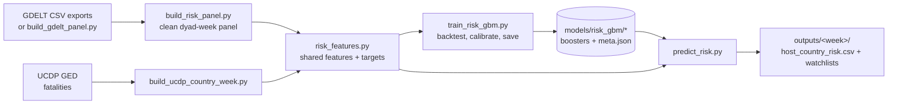

# Geopolitical Risk Forecasting

This project forecasts how relations between Middle East and North Africa (MENA) countries will develop over the next 4 to 13 weeks. It uses GDELT event data aggregated by week and by country pair. The goal is decision support for Chinese enterprises that operate abroad: flag countries and relationships that are likely to deteriorate, early enough to adjust staffing, contracts, logistics, or investment timing.

> **Status: research prototype.**
> The **v2 risk pipeline** (LightGBM, `train_risk_gbm.py` / `predict_risk.py`) is the recommended path. It produces calibrated weekly probabilities with explanations and is backtested out-of-sample. On the same test weeks, the older v1.0 transformers score about the same as a moving average or a one-line rule. See [Model assessment](#model-assessment).
> Model output is one input to a human analyst, not a decision. See [Using the outputs responsibly](#using-the-outputs-responsibly).

---

## Quick start

```bash
pip install -r requirements.txt

# --- v2 risk pipeline (recommended; local data, about 7 minutes on a laptop CPU) ---
# first: download UCDP GED (CC BY 4.0) into raw data/ucdp/ - see "Step 3" below
python build_risk_panel.py                 # step 1: clean dyad-week panel -> raw data/risk_panel.csv
python build_ucdp_country_week.py          # step 3: UCDP fatalities -> raw data/ucdp_country_week.csv
python train_risk_gbm.py                   # step 4: walk-forward backtest + final models -> models/risk_gbm/
python predict_risk.py                     # weekly watchlist -> outputs/<week>/host_country_risk.csv

# --- step 2: add China + Belt and Road host countries (needs a GCP billing project) ---
gcloud auth application-default login
python build_gdelt_panel.py --project <your-gcp-project> --dry-run    # check cost first
python build_gdelt_panel.py --project <your-gcp-project>
python build_risk_panel.py --gdelt "raw data/gdelt_panel.csv"         # then retrain + predict as above

# --- v1 (legacy) ---
python benchmark_baselines.py              # honest benchmark of the v1 task (~20 s)
python release_v1.0_goldstein.py           # v1.0 transformer (needs tensorflow)
```

The `.parquet` files used by the v1 BigQuery-based models are **not** in the repository (the `raw data/` pattern in `.gitignore` excludes them). Rebuild them with the `build_bq_panel_*.py` scripts.

---

## v2 risk pipeline

This pipeline implements the four improvement steps from the audit. Each step lists what is done and what still needs you.



### Step 1: fix the data (done, local)

`build_risk_panel.py` replaces the zero-filling in `build_goldstein_panel.py`:

| Problem | Fix |
|---|---|
| LBY/SDN Goldstein padded with 0 for all weeks (76 dyads) | Reconstructed from their CAMEO root-code counts, using per-code weights fitted on the covered dyads (held-out R² 0.98; the fitted weights match the published Goldstein scale, e.g. code 20 ≈ −10.7). Flagged with `goldstein_imputed = 1`. Weights are saved to `raw data/goldstein_root_weights.json`. |
| No-event weeks coded as Goldstein 0 ("neutral") | `goldstein = NaN` plus an explicit `n_events` column |
| Unweighted averages of weekly means | `goldstein_sum = goldstein × n_events`, so every target and trend is **event-weighted** |
| Most recent weeks dropped (no target yet) | All weeks kept. Targets are computed downstream for any horizon. |
| GDELT volume drift (3× swings) | Volume features are relative to the whole panel (`attention_share_4`, the violence-surge target) |

For the BigQuery tables, `build_gdelt_panel.py` (step 2) replaces the `COALESCE(x, 0)` queries. Its single query yields counts and Goldstein for every dyad, so nothing needs imputing.

### Step 2: China ↔ host pairs and domestic risk (code done; **you run the BigQuery pull**)

- **Domestic risk is live now.** Self-dyads (A→A = events inside country A) are graded like any other dyad, and the country model forecasts each host country's organised violence.
- **China pairs are no longer masked.** Every dyad in the panel is graded, so CHN→host and host→CHN get their own probabilities. `predict_risk.py` adds China columns to the host-country risk card when CHN is in the panel. This path was tested end to end with a synthetic CHN.
- **What you need to do:** the local CSVs contain only the 20 MENA countries. `build_gdelt_panel.py` pulls MENA + CHN + USA + 37 Belt and Road host countries (edit `EXTRA_HOSTS` in `risk_config.py`) from the public GDELT 2.0 table, billed to your GCP project:
  1. `gcloud auth application-default login` with the account that owns your billing project. The credentials currently on this machine belong to a different account and could not read `geopolitical-risk-forecasting.1.1`.
  2. Run `--dry-run` and check the estimated GB and USD. A `--max-gb` cap (default 300) makes BigQuery refuse anything larger.
  3. Run it for real, then `python build_risk_panel.py --gdelt "raw data/gdelt_panel.csv"`, `python train_risk_gbm.py`, `python predict_risk.py`.
  4. Compare the new pull with the old CSV exports for a few MENA dyads. The SQL behind the original exports is not in the repository, so small differences (for example root-event filtering) are expected.
  5. `build_gdelt_panel.py` has not been executed yet, so treat the first run as a test.

### Step 3: conflict ground truth from UCDP (done, local)

`build_ucdp_country_week.py` turns the [UCDP Georeferenced Event Dataset](https://ucdp.uu.se/downloads/) into country-week fatality counts by violence type: state-based, non-state, one-sided, and civilian deaths.

- Sources: GED 26.1 (1989–2025) plus the 2026 candidate releases (Jan–Aug 2026). For duplicate event ids, the newest file wins.
- Gaza and West Bank events, which UCDP files under "Israel", are assigned to PSE.
- Weeks after UCDP's last complete week are marked `ucdp_covered = 0` (unknown, not zero).
- **Reporting lag:** features only use UCDP data that is at least 4 weeks old (`UCDP_REPORTING_LAG_WEEKS`). Training sees the same delay as live scoring, where candidate data arrives about a month late.
- **Licensing:** UCDP is CC BY 4.0, so commercial use is fine with attribution. ACLED has better protest and riot coverage but requires a paid licence for commercial use. Check its terms before adding it.
- To refresh: download the newest `GEDEvent_v26_0_<month>.csv` from the UCDP downloads page into `raw data/ucdp/` and re-run the script.

### Step 4: LightGBM models with probabilities and explanations (done, local)

`train_risk_gbm.py` trains **six models** (3 targets × 4- and 13-week horizons):

| Model | Question it answers | Label |
|---|---|---|
| `country_escalate_h{4,13}` | Will organised violence in this country escalate? | UCDP deaths in the next H weeks ≥ max(10 / 25, 2 × the previous H weeks) |
| `dyad_violence_h{4,13}` | Will violent events between A and B surge? | Violent events (CAMEO 18–20) ≥ 2× the dyad's 26-week rate (relative to all other panel events) and ≥ 20 / 50 events |
| `dyad_worsen_h{4,13}` | Will the diplomatic tone between A and B sour? | Event-weighted Goldstein ≥ 1 point below the dyad's 26-week level |

Why two dyad targets: after Oct 7, 2023 the **average** ISR→PSE Goldstein *rose* (−3.8 → −2.4), because ceasefire, aid and diplomacy events dilute the average. The tone target therefore cannot detect wars, while the violence-surge target does. Tone remains useful for diplomatic friction, which matters for Chinese firms even without violence.

How it is evaluated and packaged:
- **Walk-forward backtest:** one fold per year, 2019–2026. Each fold trains only on data that ends at least H weeks before the test year (embargo).
- **Calibration:** Platt scaling on the last 52 weeks before each test period, so "0.30" means about 30%.
- **Seeds:** 3 seeds averaged.
- **Artifacts:** each model in `models/risk_gbm/<model>/` holds its boosters, category lists, calibrator, feature list, training windows, data SHA-256 and backtest metrics in `meta.json`. `predict_risk.py` loads them without refitting anything.
- **Drivers:** every alert lists its top 3 drivers (LightGBM SHAP contributions) in plain language.
- **In-sample warning:** `predict_risk.py` warns when the scored week falls inside a model's training window, where scores look better than reality. Use `outputs/backtest_<model>.csv` for honest historical scores.

#### Backtest results (pooled out-of-sample, 2019–2026, 20 MENA countries)

| Model | Base rate | LightGBM ROC-AUC | Best simple baseline AUC | LightGBM avg. precision | Hit rate of top-K alerts each week |
|---|---|---|---|---|---|
| country_escalate_h4 | 7.5% | **0.804** | 0.785 (country history) | 0.204 | 18% of top 5 |
| country_escalate_h13 | 8.2% | **0.799** | 0.764 (country history) | 0.224 | 19% of top 5 |
| dyad_violence_h4 | 4.2% | **0.792** | 0.736 (dyad history) | 0.122 | 16% of top 20 (3.8× base) |
| dyad_violence_h13 | 4.6% | **0.723** | 0.701 (dyad history) | 0.096 | 13% of top 20 (2.8× base) |
| dyad_worsen_h4 | 20.2% | **0.650** | 0.598 (dyad history) | 0.310 | 41% of top 20 |
| dyad_worsen_h13 | 17.8% | **0.662** | 0.596 (dyad history) | 0.307 | 45% of top 20 |

Brier scores beat a constant forecast for all six models. Calibration is good up to about 0.4. Above that, the country models over-predict (predicted ~0.5, observed ~0.3), so treat very high country scores as "high", not as a literal 50%.

**Episode checks** (out-of-sample, scored in the week just before):

| Episode | 13-week country model | Violence-surge dyad model (4w) |
|---|---|---|
| Sudan civil war, Apr 2023 | SDN rank **2 / 20**, P = 0.33 | n/a |
| Israel–Iran war, Jun 2025 | IRN rank **1 / 20**, P = 0.32 | ISR→IRN rank 65 / 400 |
| Lebanon escalation, Sep 2024 | LBN rank 6 / 20 | ISR→LBN rank 123 / 400 |
| Hamas attack, 7 Oct 2023 | PSE rank 8 / 20, P = 0.06 | PSE→ISR rank 166 / 400 (missed) |

**Interpretation.** The models add real but modest skill over each country's or dyad's own history. They are good at "this situation is heating up" and poor at surprise attacks, as expected from event histories alone. The tone watchlist still contains mean-reversion cases: dyads whose recent tone is unusually cooperative tend to fall back. Read the drivers before acting.

### Weekly operating procedure

1. Refresh the data: re-export or re-pull GDELT through last Sunday, and download the newest UCDP candidate file.
2. `python build_risk_panel.py [--gdelt ...]` and `python build_ucdp_country_week.py`
3. `python predict_risk.py`, then review `outputs/<week>/host_country_risk.csv` and the top dyad lists. Check each alert's drivers against current news.
4. Monthly: `python train_risk_gbm.py`. Compare the new backtest table with the previous `meta.json` before replacing the models in production.
5. Archive every week's `outputs/<week>/` folder. Live track records are the only real test.

---

## Repository map

| Stage | Files | Notes |
|---|---|---|
| **Raw data** | `raw data/*.csv` (66 MB, committed) | GDELT exports: weekly CAMEO root-code counts and average Goldstein score for each directed country pair (dyad), 2014-12-29 to 2026-09-21 |
| **Panel builders (CSV)** | `build_panel.py`, `build_goldstein_panel.py` | Fill in a complete 20 × 20 dyad × 613-week grid and add forward targets |
| **Panel builders (BigQuery)** | `build_bq_panel.py`, `build_bq_panel_21*.py` (+USA), `build_bq_panel_22*.py` (+USA+CHN) | Rich feature set: CAMEO counts, tone, media volume, actor diversity. Targets are computed in SQL |
| **Early models** | `train.py`, `train_bq_dnn.py`, `train_goldstein.py`, `train_goldstein_categorical.py` | Dense networks on single-week features |
| **Transformers** | `train_goldstein_transformer.py`, `train_goldstein_spatiotemporal.py`, `train_goldstein_structural*.py`, `train_v9…v12_*.py` | Attention over each dyad's 13-week history, then attention across all dyads in the same week |
| **Release candidates** | `release_goldstein_{A,B}.py`, `release_direction_{A,B}.py` | A = MENA only, B = with USA/CHN as context only (not graded) |
| **Release v1.0** | `release_v1.0_goldstein.py`, `release_v1.0_direction.py` | → `model_release_v1.0_*.weights.h5` |
| **Analysis** | `benchmark_persistence.py`, `benchmark_baselines.py`, `predict_oct7.py`, `predict_iran_israel_2026.py`, `plot_v3_predictions.py` | Case studies and benchmarks |
| **v2 config** | `risk_config.py` | Country lists (MENA, CHN, Belt and Road hosts), UCDP name mapping, reporting lag, paths |
| **v2 data** | `build_risk_panel.py`, `build_gdelt_panel.py`, `build_ucdp_country_week.py` | Clean panel (step 1), China and host-country GDELT pull (step 2), UCDP fatalities (step 3) |
| **v2 models** | `risk_features.py`, `train_risk_gbm.py`, `predict_risk.py` → `models/risk_gbm/` | Shared features and targets, backtest and training, weekly scoring (step 4) |

### Countries

20 MENA countries: ARE, BHR, CYP, DJI, EGY, IRN, IRQ, ISR, JOR, KWT, LBN, LBY, OMN, PSE, QAT, SAU, SDN, SYR, TUR, YEM.
Some panels add USA and CHN, but **only as attention context**: their dyads are masked out of the loss and are never evaluated.

### Targets

| Target | Definition | Used by |
|---|---|---|
| `target_avg_goldstein_next13w` | Mean of the weekly average Goldstein score over weeks t+1 … t+13 | goldstein regression models |
| `target_avg_goldstein_next4w` | Same, over weeks t+1 … t+4 | v10, v12, direction releases |
| direction label | `1` if the future average is **higher** than *this week's single* Goldstein value | v9, v10, v12, direction releases |
| `target_top_label_13w_ahead` | Most frequent CAMEO root code 13 weeks ahead | `train.py` |

> ⚠️ **Sign convention.** Goldstein runs from −10 (most conflictual) to +10 (most cooperative). In the direction models, label `1` = "escalation" means the score **rose**, i.e. relations became *more cooperative*. That is the opposite of the usual conflict-studies meaning. Rename the label to `improve` / `worsen` before showing it in any dashboard.

---

## Results

### Reported in the training scripts (single run each, no confidence intervals)

| Model | Task | Test metric |
|---|---|---|
| `train_goldstein.py` (v3, dense network + country embeddings) | 13w goldstein | R² 0.520 |
| spatio-temporal transformer (v6) | 13w goldstein | R² 0.604 |
| **release v1.0 goldstein** (= v11, SwiGLU, CSV features, 20 countries) | 13w goldstein | **R² 0.646, MAE 0.600** |
| release_goldstein_A / B (BigQuery features, ± USA/CHN) | 13w goldstein | R² 0.594 / 0.593 |
| v10 / v12 | 4w direction | accuracy 77.89% / 77.96% |
| **release v1.0 direction** (= release_direction_B) | 4w direction | **accuracy 77.63%** |

### Benchmark (`python benchmark_baselines.py`)

Test weeks are the same as the release model (2024-03-18 to 2026-06-22, 119 weeks). The benchmark adds a 13-week embargo before the evaluation period. "Real" means the 324 dyads with genuine Goldstein data (see [Data issues](#known-data-issues)).

| Model | R² (all 400) | MAE (all 400) | R² (real) | MAE (real) | Within-dyad R² |
|---|---|---|---|---|---|
| train mean | −0.010 | 1.140 | 0.000 | 1.238 | 0.000 |
| persistence (this week) | −1.107 | 1.334 | −1.184 | 1.647 | −6.83 |
| per-dyad historical mean | 0.415 | 0.738 | 0.394 | 0.911 | 0.000 |
| trailing 13-week mean | 0.559 | 0.664 | 0.543 | 0.820 | −0.61 |
| **trailing 26-week mean** | **0.635** | **0.601** | 0.621 | 0.742 | −0.29 |
| **gradient boosting, lag features** (trains in seconds on CPU) | **0.642** | **0.577** | 0.629 | 0.708 | 0.03 |
| release v1.0 goldstein (reported) | 0.646 | 0.600 | n/a | n/a | n/a |

**Direction label.** The rule "if this week is below its own 13-week trailing mean, predict *rise*" reaches **80.4%** accuracy at the 4-week horizon (majority class: 62.3%). The release v1.0 direction model reports 77.6%. The rule was computed on the CSV Goldstein series, not the BigQuery `goldstein_mean`, so the comparison is approximate but indicative.

**Deterioration alert** (new task, 324 real dyads). Label = 1 when the next-13-week mean ends up at least 1.0 point **below** the dyad's trailing 26-week mean. Base rate: 14.1%.

| Score | ROC-AUC | Avg. precision | Precision of the top 20 alerts each week |
|---|---|---|---|
| recent momentum (4w vs 26w mean) | 0.546 | 0.166 | 17.8% |
| 4-week material-conflict share | 0.503 | 0.148 | 16.8% |
| **gradient boosting classifier** | **0.691** | **0.280** | **37.3%** |

How to read these results:

1. **The headline R² mostly measures which dyads are hostile on average, not what will change.** Within-dyad R² is about 0 for every method that could be checked. Knowing that ISR→PSE is usually negative already gets you most of the score. The value for a risk desk is in predicting *changes*, and nothing here does that well yet.
2. **The transformer adds little beyond smoothing.** A 26-week moving average matches it. A gradient-boosted tree on about 30 hand-built lag features (`benchmark_baselines.py`) matches its R² and beats its MAE, even with less training data because of the embargo.
3. **The direction label is mostly regression to the mean.** It compares one noisy week against a multi-week average. When a week is unusually negative, the average that follows is almost always higher. The model's 77% accuracy is therefore not evidence that it can forecast escalation.
4. **The alert task gives a usable but modest signal:** about 2.6× lift over the base rate in the top-20 watchlist. This framing (ranked weekly alerts relative to each dyad's own normal) fits decision support better than raw Goldstein regression.

---

## Model assessment

### Are the models fit for the data?

| Aspect | Finding | Impact |
|---|---|---|
| **Sample size vs. capacity** | About 600 weekly snapshots, each target averaging 13 overlapping weeks, so only about 45 independent quarters. The transformers have about 0.5 M parameters. | High risk of overfitting. Gains between versions (0.604 → 0.646, 77.6% vs 77.9%) are within single-seed noise. |
| **Architecture** | Cross-dyad attention over 400 to 484 tokens assumes the dyad set never changes (`N_DYADS_PER_WEEK` is hard-coded). | Adding one country means retraining from scratch. The model cannot score a new country such as KAZ or PAK. |
| **Target** | Goldstein is a fixed weight per CAMEO code, averaged over events. Weeks with no events are coded 0 = "neutral". | It mixes rhetoric with violence, shrinks quiet dyads toward 0, and is dominated by media volume. |
| **Validation** | Single chronological split, one seed, no embargo, comparisons only against weak baselines. | Reported improvements are not established. |
| **Business alignment** | China's dyads are context only and are never evaluated. There is no host-country *domestic* risk output, and no probability calibration. | The output does not yet answer "is it riskier for a Chinese firm to operate in country X next quarter?" |

### Known data issues

Issues 1–5, 7 and 8 are fixed in the [v2 risk pipeline](#v2-risk-pipeline). The v1 scripts are left unchanged so their published results stay reproducible.

1. **LBY/SDN fake zeros.** `build_goldstein_panel.py` pads Goldstein to 0 for every week of the 76 dyads involving Libya or Sudan, because the Goldstein source did not cover them. Event *counts* do exist for these dyads in 69% of weeks. These dyads (19% of the panel) have a constant target of 0, which inflates R² and teaches the model that Libya and Sudan are calm. Both countries had active civil wars during the sample period.
2. **"No events" coded as "neutral".** In 20% of dyad-weeks there are zero events, and Goldstein is set to 0. The BigQuery builders use `COALESCE(x, 0)` on every numeric column, tone and Goldstein included. Missing data should stay missing, with an explicit `n_events` / `has_events` feature.
3. **Unweighted target.** The target averages *weekly means*, so a week with 1 event counts as much as a week with 5,000. Weight by event count, or by `NumMentions`.
4. **GDELT volume drift.** Event volume in the 20-country panel swings 3× across the sample: 3.2 M (2016), 0.94 M (2022), 2.75 M (2024). Raw `log1p(count)` features are non-stationary. Normalise by total GDELT volume for the week, or use shares.
5. **Live inference gap in BigQuery panels.** The SQL keeps only rows that have a complete future window (`WHERE n_future_weeks = H`). The most recent H weeks, which a live forecast needs, are therefore **not in the parquet at all**. Only the CSV pipeline keeps them (with a NaN target).
6. **Zero-padded USA/CHN pair dyads.** USA↔USA, CHN↔CHN, USA↔CHN and CHN↔USA are filled with zeros, *including the target*, and fed to attention as if they were real observations.
7. **No embargo.** Training targets near the end of the training period average weeks that fall inside the validation period.
8. **Artifacts are not reproducible on their own.** Scalers and encoders are never saved. Inference scripts refit them from whatever CSV is on disk, so refreshing the data silently shifts the inputs. `predict_*.py` load the older `model_goldstein_spatiotemporal.keras`, and no inference script exists for the v1.0 release weights.
9. **Raw data is committed despite `.gitignore`.** The CSVs were committed before the ignore rule was added. Consider Git LFS or DVC with versioned BigQuery snapshots.

---

## Improvement roadmap

Ordered by expected value per unit of effort.

### P0: correctness (before any further modelling)
- [x] Remove or properly source the LBY/SDN Goldstein data. Keep missing values as NaN plus a `has_events` flag (v2: `build_risk_panel.py`; `build_gdelt_panel.py` creates no padded dyads).
- [x] Weight targets by event count. Normalise counts by GDELT volume (v2 uses the panel's total volume; global volume would be better).
- [x] Keep the most recent weeks so live scoring is possible (v2 keeps every week; the v1 BigQuery builders still drop them).
- [x] Retire the direction label. v2 uses `worsen` / `violence` / `escalate` (the v1 scripts are unchanged).
- [x] Save the preprocessing artifacts next to each model, and load them in a single prediction script (`models/risk_gbm/*/meta.json`, `predict_risk.py`).

### P1: evaluation you can trust
- [x] Rolling-origin (walk-forward) backtests with an embargo of at least H weeks and 3 seeds (`train_risk_gbm.py`).
- [ ] Block-bootstrap confidence intervals on the backtest metrics.
- [x] Always report simple baselines next to any model (`benchmark_baselines.py` for v1; history and recent-trend baselines in every v2 fold).
- [x] Event-based checks of major episodes (the `EPISODES` list in `train_risk_gbm.py`) and precision of the top-K alerts.
- [ ] Add more episodes (Red Sea / Houthi shipping attacks once USA and the shipping states are in the panel) and recall at a fixed alert budget.
- [x] Replace the "future vs. this week" direction label with labels relative to a stable baseline (tone worsening, violence surge, UCDP escalation).

### P2: better data and targets for *conflict*
- [x] **Add UCDP-GED** (fatalities; `build_ucdp_country_week.py`).
- [ ] Add ACLED for protests and riots (needs a commercial licence) and subnational resolution, because sites and staff sit in specific provinces, not whole countries.
- [x] Conflict-specific targets: violent-event surge (CAMEO 18–20), UCDP fatalities, and a **domestic** risk score per host country.
- [ ] Protest-specific target (CAMEO 14, or ACLED) for labour and anti-project unrest.
- [ ] Structural covariates that change slowly: governance indicators (World Bank WGI), elections calendar, sanctions designations, FX/inflation stress, commodity prices.
- [ ] Treat GDELT media coverage as a *leading indicator feature*, not as the target.

### P3: modelling
- [x] Gradient boosting (LightGBM) with lag, rolling and country-context features, plus SHAP explanations.
- [ ] Neighbour and graph features (conflict in bordering countries, alliance blocs).
- [x] Calibrated probability outputs (Platt scaling). Over-prediction above 0.4 in the country models still needs fixing, e.g. with isotonic calibration once more data is available.
- [ ] If deep models are kept, use a graph neural network over countries (works with any number of countries) instead of fixed 400-token attention. Pre-train across all GDELT countries, then fine-tune on the target region.
- [ ] Combine the gradient-boosting model, a trailing-mean model and the transformer in a simple ensemble. Ensembles of simple models are hard to beat in conflict forecasting.

### P4: decision support for Chinese enterprises abroad
- [x] **Evaluate CHN dyads instead of masking them.** Done in code; needs the `build_gdelt_panel.py` pull to get CHN data.
- [ ] Expand coverage beyond MENA to where Chinese enterprises have exposure. Code done (`EXTRA_HOSTS` in `risk_config.py`, 37 countries); needs the `build_gdelt_panel.py` pull plus retraining.
- [ ] Ingest Chinese-language sources (GDELT Translingual already covers part of this; MOFCOM/MFA travel and safety advisories).
- [x] Report output **per country and per horizon** (4w and 13w host-country risk card).
- [ ] Add a 52-week horizon for investment decisions (needs structural covariates from P2).
- [x] For every alert, show the main drivers (SHAP).
- [ ] Attach recent example events (GDELT `SOURCEURL`) so an analyst can verify each alert.
- [ ] Monitor data freshness, feature drift and live accuracy. Re-score weekly and archive every forecast (see the weekly operating procedure).

---

## Using the outputs responsibly

- Treat model output as **one input to a human analyst**, never as an automatic decision. Event data reflects media attention, which is biased toward English-language and high-profile stories and against remote or censored areas.
- Prefer **relative** signals ("worse than this dyad's own normal") over absolute Goldstein levels.
- Sudden shocks (coups, assassinations, surprise attacks such as Oct 7) are largely unpredictable from event histories. This system's realistic job is to flag **sustained deteriorations** early.
- Re-validate before every release. Results from 2015–2022 training data may not hold after structural breaks such as the post-2023 regional war.

---

## License

MIT. See [LICENSE](LICENSE).
