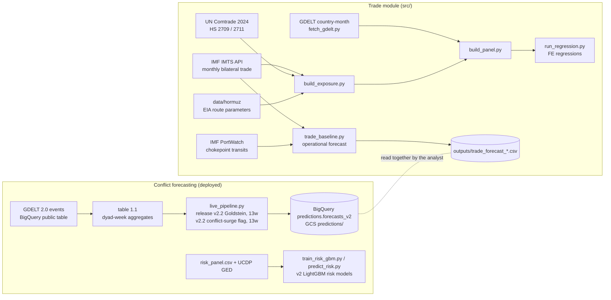

# Pipeline summary (status 2026-10-15)

The project has two linked parts:

1. **Conflict forecasting.** It forecasts how relations between MENA countries will develop over the next 4–13 weeks, from GDELT events.
2. **Trade module.** It measures whether conflict around critical infrastructure (above all the Strait of Hormuz) spills over into China's trade with the region, and forecasts that trade 13 weeks ahead.

Both serve the same purpose: early warning for Chinese enterprises operating abroad.

Every number below can be regenerated from the repository. The trade-module numbers come from `paper/compute_trade_stats.py`, which writes `paper/trade_stats.json`.

---

## 1. Overview



| Component | Status | Refresh |
|---|---|---|
| Conflict forecasts (release v2.2 Goldstein + v2.2 conflict-surge flag) | Cloud Function `run-pipeline`; `deploy.sh` targets v2.2 (commit ea6ed05) | Every 2nd week (Cloud Scheduler, Tuesdays 06:00 UTC) |
| v2 LightGBM risk models | Local | Monthly retrain, weekly scoring (README "Weekly operating procedure") |
| Trade source tables (IMF IMTS, PortWatch → BigQuery `trade.*`) | Code ready (`cloud_function/deploy_trade.sh`), not yet deployed | Weekly, Tuesdays 07:00 UTC once deployed |
| Trade regressions | Local | Rerun after each data refresh |
| Trade forecast (shrunk persistence) | Local, operational model | Rerun after each data refresh (~2 s) |
| Trade transformer | Research track, not used for forecasts | Retrain before reuse |

---

## 2. Conflict forecasting (summary; details in the transformer section)

Release v2.2 (commit ea6ed05) replaces v2.1 Goldstein + v2.0 direction in the live pipeline. Numbers from `paper/v22_stats.json`.

- **Unit:** directed country pair (dyad) × week, 20 MENA countries (400 graded dyads). 1,559 dyads linking MENA to the rest of the world serve as attention context. v2.2 also trains on 5,122 world dyads.
- **Goldstein model v2.2** (`goldstein_forecast_next13w`, read against `goldstein_trailing52w`):
  - Target: mean Goldstein score over the next 13 weeks (−10 = most conflictual, +10 = most cooperative).
  - Architecture: a temporal transformer over each dyad's last 13 weeks, cross-dyad attention, country embeddings and SwiGLU. The output is a residual on the 52-week mean. Five-seed ensemble.
  - Test: R² 0.658, **14.4% lower MSE than the trailing 52-week mean** (v2.1: 11.7%), change correlation 0.38, deterioration AUC 0.66.
  - Most of the R² reflects stable differences between dyads, not change.
- **Conflict-surge flag v2.2** (`conflict_surge_probability`, `surge_alert` for the top-ranked dyads):
  - Probability that the next quarter's peak 4-week conflict intensity exceeds the dyad's normal by more than the worst 10% of training-period gaps.
  - Hostile events only, so diplomacy cannot mask fighting.
  - Test: AUC 0.64 on surges (base rate 14%); 44% of the top-10 flags are real surges.
- **Retired:** the v2.0 direction model's 4-week label mostly captured bounce-back after unusual weeks (AUC 0.49 on conflict surges). The v1.0-era direction models had the opposite sign convention; their scripts now say `improve`.
- **v2 LightGBM risk models:** calibrated probabilities for country violence escalation (UCDP), dyad violence surges and dyad tone deterioration, at 4 and 13 weeks, backtested walk-forward 2019–2026.

---

## 3. Trade module

### 3.1 Data

| Source | Content | Range | Script / location |
|---|---|---|---|
| IMF IMTS (SDMX 3.0 API, no key) | China's monthly goods exports (FOB) and imports (CIF) with 20 MENA countries + USA + World; partner-reported mirror series | 2017-01 – 2026-06 (IMF publishes with a ~3–4 month lag) | `src/fetch_imf_imts.py` → `data/imf_imts/imts_raw.csv` |
| UN Comtrade (API key in `.env`) | China's 2024 imports of crude oil (HS 2709) and petroleum gases (HS 2711) by partner | 2024 (China's monthly Comtrade data ends 2024-12) | `src/fetch_comtrade_energy.py` |
| Hormuz route parameters | Share of each exporter's energy shipments that cannot bypass Hormuz, low/high case | Checked against EIA, 2026-10-14 | `data/hormuz/hormuz_dependence.csv` (hand-built, sourced) |
| GDELT 2.0 events, by event location | Country-month conflict index (counts, T2–T4 share, material-conflict share, Goldstein) | 2017-01 – 2026-10 | `sql/gdelt_country_month.sql`, `src/fetch_gdelt.py` |
| GDELT dyad-week panel | Weekly events among the 20 MENA countries | 2014-12-29 – 2026-09-21 | `data/risk_panel.csv` (used by the trade transformer) |
| IMF PortWatch (public ArcGIS service, no key) | Daily vessel transits and capacity: Hormuz, Bab el-Mandeb, Suez, Cape of Good Hope, Malacca | 2019-01-01 – 2026-10-11 (no earlier data exist) | `src/fetch_portwatch.py` → `data/portwatch/` |

Shared download code is in `src/trade_sources.py`. It is used both by the local scripts and by the `trade-refresh` Cloud Function.

### 3.2 Processing chain

```bash
python src/fetch_imf_imts.py && python src/fetch_portwatch.py      # (+ fetch_comtrade_energy.py, fetch_gdelt.py when needed)
python src/build_exposure.py        # Hormuz-exposed energy imports per partner (low/high)
python src/build_panel.py           # country x month panel, fixed end month = last trade month
python src/check_trade_data.py      # units, mirror independence, gaps, revealed dependence
python src/run_regression.py        # 85 fixed-effects specifications + permutation tests
python src/trade_baseline.py        # walk-forward backtest + latest 13-week forecast
python paper/compute_trade_stats.py # numbers for the paper
python paper/make_trade_figures.py  # fig_trade_1..3
python paper/build_trade_docx.py    # trade_section.docx from trade_section_draft.md
```

### 3.3 Main decisions

| Decision | Reason |
|---|---|
| IMF IMTS as the main trade source, not Comtrade | Comtrade's China monthly data stop in 2024-12; IMF covers all 21 partners to 2026-06. |
| China-reported data, not mirror data | For IRQ, ARE, IRN, DJI, YEM and LBY the IMF derives the partner-reported series from China's figures (constant 1.06 CIF/FOB ratio), so they are not independent. Kuwait and Oman report almost no oil exports to China. |
| Exposure parameters set from EIA route data, never from 2026 outcomes | Fitting them to the 2026 trade drop would make the regression circular. The 2026 drops are used only as a validation check. |
| Missing months = unknown, not zero | Prevents spurious collapses, e.g. Libya's missing 2020-05 import month. |
| 100-day publication lag in the forecast | Matches what the IMF has actually published (on 2026-10-14 the latest month was 2026-06). |
| Shrunk persistence as the operational forecast; transformer shelved | The transformer did not beat the two-parameter baseline out of sample (Section 6 of the trade draft). |

### 3.4 Outputs

| File | Content |
|---|---|
| `data/processed/exposure_table.csv` | Hormuz-exposed energy imports per partner (bn USD, shares), low/high |
| `data/processed/panel_country_month.csv` | 21 countries × 114 months: trade, conflict, exposure |
| `data/processed/regression_results.csv` | Coefficients, four kinds of standard errors, permutation p-values |
| `data/processed/mirror_check.csv`, `revealed_dependence_2026.csv` | Data-quality and validation checks |
| `models/trade_baseline/meta.json` | Fitted factors k, interval quantiles, backtest metrics |
| `data/processed/trade_baseline_backtest.csv` | Every out-of-sample forecast, 2020–2026 |
| `outputs/trade_forecast_<origin>.csv` | Latest forecast: % change, 80% interval, latest change, Hormuz flag |

### 3.5 Cloud integration

- `cloud_function/trade_refresh.py` is a separate Cloud Function, so a failure cannot affect the conflict forecasts. Each run fully reloads BigQuery `trade.imf_imts_raw` and `trade.portwatch_daily`.
- Deploy with `gcloud auth login` and then `bash cloud_function/deploy_trade.sh`. This needs no model files.
- The conflict forecasting function is unchanged and will not be redeployed.

---

## 4. How the outputs are read together

| Conflict forecasts (v2.2, 13 weeks) | Trade forecast (13 weeks) | Reading |
|---|---|---|
| `surge_alert` on, or Goldstein forecast below `goldstein_trailing52w`, for dyads involving the partner | Flat or positive | Trade data (3–4 months old) cannot show it yet. For Hormuz-exposed partners, plan around the lower end of the trade interval. |
| Stable | Sharp recent drop | Probably not conflict-driven (prices, cargo timing). Expect partial reversion, as the baseline does. |
| Surge alert or deterioration | Falling, Hormuz flag on | Disruption likely to persist. Use the latest change or the interval's lower end. |
| Stable | Stable | Normal conditions. Use the point forecast. |

The regression gives the scale of a chokepoint shock. A sustained 1-SD rise in Gulf conflict over four months lowers import growth from a fully exposed partner by about 0.45 log points. This is identified from the 2026 episode alone, so use it for scenarios, not as a forecast.

---

## 5. Known gaps

- PortWatch is downloaded but not yet a model input.
- The Saudi bypass was attacked in Sep 2026, so a static dependence parameter understates time variation.
- Import forecast intervals are too narrow (71% coverage for a nominal 80%).
- The trade transformer's saved weights predate the parameter revision and the missing-month fix.
- China customs data (about 3 weeks after month end) would roughly double export forecast skill, but is not automated.
