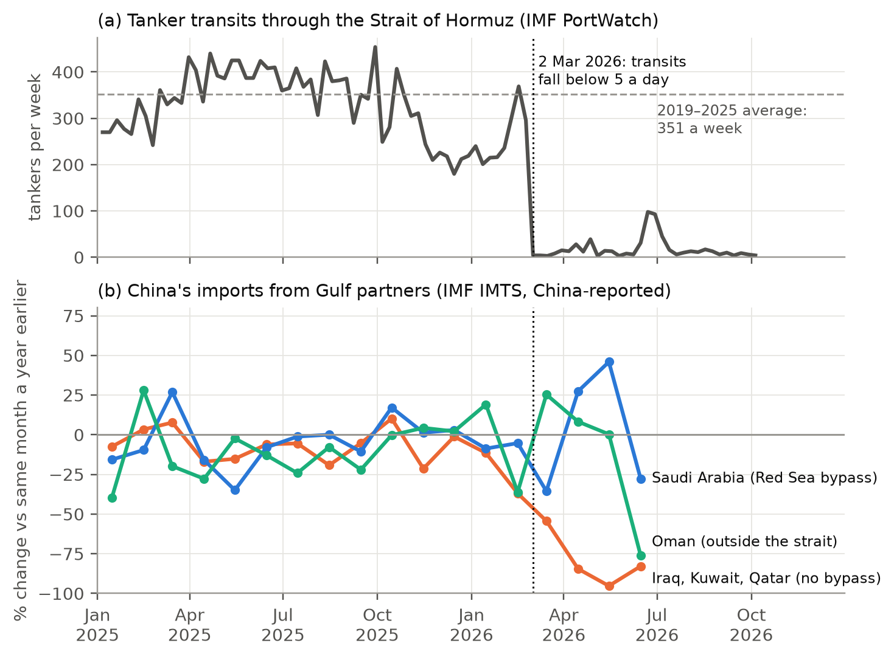
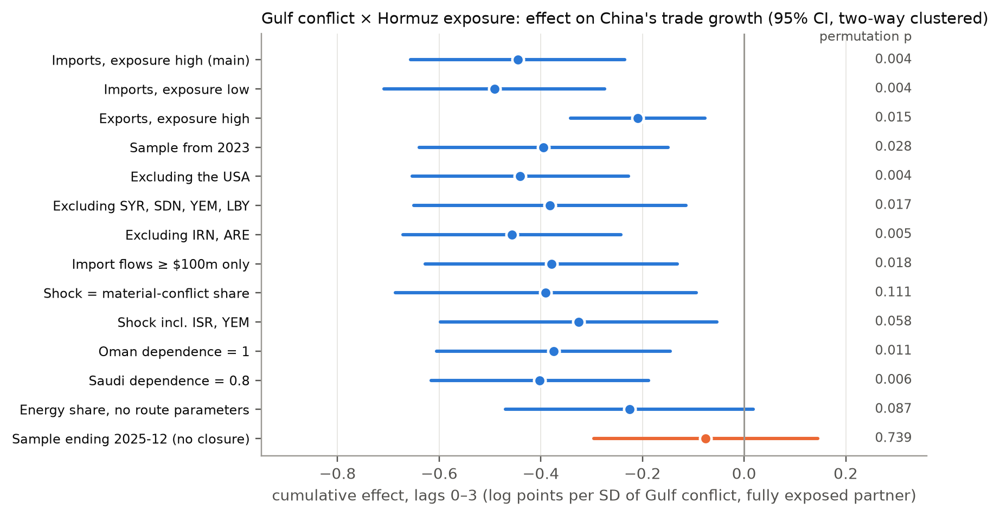
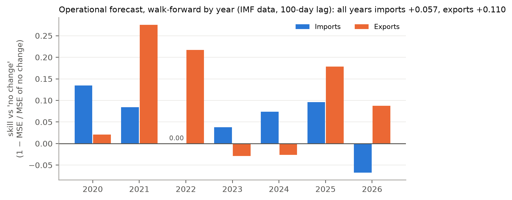

# From conflict to trade: the Strait of Hormuz and China's trade with the Middle East

*Draft section, 2026-10-15. All numbers come from `paper/trade_stats.json` (`python paper/compute_trade_stats.py`). Items marked **[verify]** rest on a source that should be re-checked before submission.*

---

## Section summary

The conflict-forecasting section asks whether relations between MENA countries will deteriorate. This section asks whether such deterioration matters for China's trade with the region, and whether that trade can be forecast.

- **Data.** We combine monthly IMF trade data (China and 20 MENA partners plus the United States, 2017-01 to 2026-06) with GDELT conflict data and IMF PortWatch chokepoint transits. Each partner's exposure to the Strait of Hormuz is built from EIA descriptions of export routes.
- **The 2026 closure.** In March 2026 the strait was effectively closed. Tanker transits fell from about 50 a day to 2–3, and China's imports from Iraq, Qatar and Kuwait fell by 83–89% year on year in the second quarter. Imports from Saudi Arabia, which can export from the Red Sea, rose by 12%.
- **Regression.** In a fixed-effects design, a Gulf conflict shock lowers import growth from Hormuz-exposed partners: a cumulative −0.45 log points per standard deviation sustained over four months, for a fully exposed partner (permutation p = 0.004).
- **One episode.** The effect is identified by the 2026 episode alone. In data ending in 2025 it is zero.
- **Forecasting.** A country × week transformer did not beat a two-parameter rule out of sample. We therefore use shrunk persistence as the operational forecast. Its skill is modest: 6–11% lower squared error than "no change" with IMF data, about twice that with China customs data. No model anticipated the 2026 collapse, because the training history contains no comparable event.

---

## 1  Question and approach

Chinese firms in the Middle East are exposed to conflict through two channels:
- **Directly:** violence at the place of operation.
- **Indirectly:** disruption of the routes that carry the region's trade with China.

The second channel is concentrated in a few chokepoints. The most important is the Strait of Hormuz, through which most Gulf oil and LNG exports pass.

We ask three questions:
1. How exposed is China's trade with each MENA partner to a Hormuz disruption?
2. Does Gulf conflict reduce China's trade more for more exposed partners?
3. Can China's trade with each partner be forecast one quarter ahead, and does conflict information help?

The first is answered by constructing exposure from route data (Section 3), the second by a shift-share style regression (Section 5), and the third by forecasting experiments (Section 6).

---

## 2  Data

### 2.1  Trade

**Source.** China's monthly bilateral goods trade comes from the IMF International Merchandise Trade Statistics (IMTS), China-reported:
- exports FOB, imports CIF;
- 20 MENA partners plus the United States and the World aggregate;
- 2017-01 to 2026-06, 9,681 observations.

**Why not UN Comtrade.** Comtrade's China monthly data end in December 2024 and cannot cover the 2026 events. Comtrade is used only for the commodity composition of China's 2024 imports from each partner: crude oil (HS 2709) and petroleum gases (HS 2711).

**Data checks.**
- *Units.* IMF values are full US dollars. China's 2024 totals in the IMF data ($3,580 bn exports, $2,587 bn imports) match the customs (GACS) headline figures **[verify GACS figures against the January 2025 release]**.
- *Missing months.* Import values are missing for Palestine (13 months), Djibouti (2) and Libya (1). They are treated as unknown, never as zero.
- *Mirror data.* The partner-reported series are not independent of China's figures for six partners: IRQ, ARE, IRN, DJI, YEM and LBY. For these, the IMF reports estimates (status "e") at a constant 1.06 ratio to China's data, a standard CIF/FOB adjustment. Kuwait and Oman report almost no oil exports to China. A robustness check that replaces China-reported with partner-reported data is therefore not informative for the exposed partners, and we do not use one.
- *Coding.* Palestine is coded WBG in IMF data and mapped to PSE.

### 2.2  Conflict

Conflict is measured from GDELT 2.0 events, aggregated by event location (`ActionGeo`, FIPS codes mapped to ISO3) to country × month, 2017-01 to 2026-10.

The main measure is the share of events in CAMEO root codes 15, 18, 19 and 20: military posture, assault, fight and mass violence. A share rather than a count removes the drift in GDELT's media coverage.

The Gulf shock is the mean of this share across the eight Hormuz littoral states (IRN, IRQ, KWT, SAU, ARE, BHR, QAT, OMN), standardised over months.

### 2.3  Chokepoint transits

IMF PortWatch reports daily vessel transits and cargo capacity through 28 maritime chokepoints, from 2019-01-01. We use the Strait of Hormuz, Bab el-Mandeb, the Suez Canal, the Cape of Good Hope and the Strait of Malacca.

In this section PortWatch serves as descriptive evidence and as a flag in the forecast output. It is not yet a model input.

---

## 3  Hormuz exposure

### 3.1  Definition

For partner *i* and scenario *s* ∈ {low, high}:

> exposed_i,s = crude_i × dep^crude_i,s + gas_i × dep^gas_i,s

- crude_i and gas_i are China's 2024 imports of HS 2709 and HS 2711 from *i*, in USD.
- dep is the share of the partner's exports that cannot bypass the strait.

The regressor is the exposed value divided by China's total 2024 imports from *i*. This is a predetermined share in [0, 1].

### 3.2  Route parameters

Parameters are set from EIA descriptions of export infrastructure, checked on 2026-10-14 (Appendix A1). They are never fitted to the 2026 trade outcomes, which would make the regression circular.

**Hormuz dependence parameters (share of exports that cannot bypass the strait)**

| Partner | dep (crude), low – high | Basis |
|---|---|---|
| Iraq | 0.88 – 1.00 | All 2024 seaborne exports left from southern Gulf terminals (EIA, July 2025). The Iraq–Türkiye pipeline carried about 0.4 mb/d of northern crude before its 2023–2025 closure and cannot carry Basra grades. |
| Kuwait, Qatar, Bahrain | 1.00 | No outlet outside the strait; only Saudi Arabia and the UAE can reroute (EIA). |
| UAE | 0.44 – 0.66 | 1.8 mb/d Habshan–Fujairah pipeline against 3.2 mb/d of total exports (EIA, July 2026). LNG loads at Das Island, inside the Gulf: 1.00. |
| Saudi Arabia | 0.08 – 0.45 | East–West pipeline to Yanbu, about 5 mb/d available for exports; spare capacity estimates differ (IEA; EIA, June 2025). |
| Iran | 0.88 – 1.00 | Goreh–Jask pipeline, about 0.3 mb/d effective. China's recorded crude imports from Iran are near zero, so the parameter does not affect exposure. |
| Oman | 0 | Terminals at Mina al-Fahal and Sohar (Gulf of Oman) and Duqm (Arabian Sea) lie outside the strait (EIA). |

### 3.3  Magnitude

- China's Hormuz-exposed energy imports in 2024 are **$79.7–107.1 bn**, or **3.1–4.1%** of its total imports ($2,587 bn).
- Five partners carry material exposure: Iraq, Saudi Arabia, the UAE, Qatar and Kuwait.
- Oman, China's third-largest energy supplier in the region ($27.4 bn), is unexposed by route. Treating Oman as fully exposed would raise the upper bound by about $27 bn.

---

## 4  The 2026 closure

**Timeline.**
- Violent events in the weekly GDELT panel rose from about 3,800 a week in January–February 2026 to **30,352 in the week of 2 March**, eight times the earlier level.
- In the monthly index, the Gulf shock reached **7.5 standard deviations** in March 2026. The largest value in the preceding nine years was 2.0 (January 2024).
- PortWatch shows Hormuz tanker transits averaging **50 a day in 2019–2025** and 37 a day in January–February 2026. They fell below five a day on **2 March 2026** and averaged **2.5 a day** from then to October, and 0.8 a day in the most recent four weeks.



**Effect on China's imports, April–June 2026 vs April–June 2025 (USD value):**

| Partner | Change | Implied energy dependence | Assumed dep (low – high) |
|---|---|---|---|
| Iraq | −89% | 0.91 | 0.88 – 1.00 |
| Qatar | −88% | 0.96 | 1.00 |
| Kuwait | −83% | 0.93 | 1.00 |
| UAE | −75% | 1.01 | 0.44 – 0.66 |
| Oman | −20% (flat Apr–May, −76% in June) | 0.23 | 0 |
| Saudi Arabia | +12% | < 0 | 0.08 – 0.45 |
| World (China's total imports) | +30% | — | — |

"Implied energy dependence" is the observed fall divided by the partner's energy share of China's imports. It is a lower bound, because oil prices rose and values understate volumes.

How this compares with the assumed parameters:
- **Consistent:** Iraq, Kuwait, Qatar and Saudi Arabia match the route parameters.
- **UAE:** the fall is larger than the route parameters imply. Fujairah capacity appears not to have been allocated to China-bound cargoes.
- **Oman:** the June drop points to indirect war-risk effects in the Gulf of Oman that a route parameter cannot capture.
- **Saudi Arabia:** EIA reports that attacks on the East–West pipeline in September 2026 temporarily halted the bypass. Saudi dependence is therefore time-varying.

---

## 5  Does Gulf conflict reduce trade with exposed partners?

### 5.1  Design

For partner *i* and month *t*:

- (A) own conflict: y_it = β c_i,t−k + α_i + γ_t + ε_it
- (B) Gulf shock × exposure: y_it = β gulf_t−k × exposure_i + α_i + γ_t + ε_it

**Variables.**
- y_it is the 12-month log change of China's imports from (or exports to) *i*, which removes seasonality and level differences.
- c_i,t is the standardised conflict share of partner *i*.

**Identification.** Partner and month fixed effects absorb the main effects of exposure and of the shock. Identification therefore comes from the interaction: whether partners with higher predetermined exposure fare worse in months of high Gulf conflict. This is a continuous-treatment difference-in-differences, or shift-share design.

**Lags.** Each lag k = 0…3 is estimated separately, and all four lags are also estimated jointly. Because the Gulf shock is autocorrelated, single-lag estimates partly proxy for one another. The **cumulative effect** (the sum of the joint lag coefficients) is the main quantity.

The sample runs 2018-01 to 2026-06: 21 partners, 102 months, 2,117 import observations.

### 5.2  Inference

The shock is common to all partners in a month, so the effective number of independent observations is close to the number of months. Only five partners carry material exposure. We report four kinds of inference:
1. two-way clustered standard errors (partner and month; Cameron, Gelbach and Miller, 2011), with eigenvalue clipping when the variance matrix is not positive semi-definite;
2. month-clustered standard errors;
3. Driscoll–Kraay standard errors (three lags);
4. randomisation inference: exposure is reassigned across partners 999 times.

The permutation p-value is the most credible of the four, given the small number of treated units.

**Simulation check.** On a simulated panel with a planted lag-1 effect of −0.3, the estimator recovers −0.29. Clustering by partner alone, as in an earlier draft of this analysis, produced spuriously small p-values.

### 5.3  Results

**Cumulative effect, lags 0–3 jointly**

| Specification | β | Two-way p | Permutation p |
|---|---|---|---|
| Imports, exposure high | −0.446 | 0.001 | 0.004 |
| Imports, exposure low | −0.491 | <0.001 | 0.004 |
| Exports, exposure high | −0.209 | 0.006 | 0.015 |
| Exports, exposure low | −0.225 | 0.004 | 0.011 |
| Own conflict (A), imports | −0.192 | 0.43 | — |

**Imports, high exposure, single lags:** −0.28 (k = 0), −0.25 (k = 1), −0.31 (k = 2) and −0.13 (k = 3). Permutation p-values are 0.012, 0.011, 0.003 and 0.082.

**Reading the cumulative effect.** It is the change in 12-month import growth for a fully exposed partner (exposure = 1) when the Gulf shock is one standard deviation higher for four consecutive months.

**Back-of-envelope check.** The Gulf shock averaged about 3.2 standard deviations over March–June 2026. A fully exposed partner would then lose roughly 0.45 × 3.2 ≈ 1.4 log points, about −76%. Observed second-quarter falls for Iraq, Qatar and Kuwait were −83% to −89%. The linear specification captures most, but not all, of the collapse.

**Other findings.**
- Own-country conflict (specification A) has no detectable effect on trade. Conflict matters for trade through the shipping route, not through the partner's own instability.
- China's exports to exposed partners also fell, by about half the import effect. Inbound shipping to Gulf ports was disrupted too.

### 5.4  Robustness

**Robustness: imports, high exposure, cumulative effect, lags 0–3**

| Variant | β | Permutation p |
|---|---|---|
| Baseline | −0.446 | 0.004 |
| Sample from 2023 | −0.395 | 0.028 |
| Excluding the USA | −0.441 | 0.004 |
| Excluding SYR, SDN, YEM, LBY (war-affected) | −0.382 | 0.017 |
| Excluding IRN and ARE (sanctions, re-exports) | −0.457 | 0.005 |
| Import flows ≥ $100 m in 2024 only | −0.379 | 0.018 |
| Shock = material-conflict share | −0.390 | 0.111 |
| Shock includes ISR and YEM | −0.326 | 0.058 |
| Oman dependence = 1 | −0.375 | 0.011 |
| Saudi dependence = 0.8 | −0.402 | 0.006 |
| Energy share without route parameters | −0.226 | 0.087 |
| **Sample ending 2025-12 (no 2026 closure)** | **−0.075** | **0.739** |



Two results stand out.

**1. The effect is identified by one episode.**
- Without 2026, the coefficient is a small fraction of its full-sample value and indistinguishable from zero.
- Gulf conflict between 2018 and 2025 included the 2019 tanker attacks, the Red Sea crisis of 2023–24 and the June 2025 Israel–Iran war. None of these moved China's trade with exposed partners measurably.
- The estimate therefore describes what happens when the strait actually closes, not a general elasticity of trade to Gulf conflict.

**2. Route information matters.** Replacing route-based exposure with the raw energy share of imports roughly halves the coefficient and weakens its significance. Partners whose energy exports could bypass the strait (Saudi Arabia, Oman) behaved differently from those that could not.

The results are not sensitive to the parameter revision of October 2026. With the earlier, secondary-source parameters the cumulative effects were −0.45 (high) and −0.55 (low).

---

## 6  Forecasting China's trade one quarter ahead

### 6.1  Task

At the end of each week, for each of the 20 MENA partners and each flow, we forecast the year-on-year log change of China's trade over the next 13 weeks:

> y = log(trade over days [O, O+91)) − log(trade over the same days one year earlier)

- O is the forecast origin; exp(y) − 1 is the % change.
- Monthly values are spread evenly over days.
- The year-on-year form removes Chinese New Year seasonality.
- Flows below $100 m in the last published 12 months are not graded.

**Information set.** A trade month is used only after it would have been published:
- 100 days after month end for the IMF data that the automated pipeline uses (on 2026-10-14 the IMF's latest month was June 2026);
- 28 days for China customs releases.

### 6.2  A spatio-temporal transformer

The first model mirrors the conflict transformer, with countries as tokens. It has 45,714 parameters: model width 32, four heads, SwiGLU feed-forward layers and an eight-dimensional country embedding.

- **Temporal transformer:** each partner attends over its own last 13 weeks of inputs. The 25 inputs are weekly GDELT conflict measures, UCDP deaths, monthly location-based GDELT, published trade growth, China's world trade growth, data staleness and season.
- **Contextual transformer:** each partner attends to the other 19 partners in the same week.
- **Training:** five-seed ensembles, early stopping on a validation year (2023-10 to 2024-09), test on 2025-01 to 2026-03 with 13-week embargoes. Publication lag 28 days.

**Trade transformer and benchmarks: test skill, 1 − MSE / MSE of "no change" (2025-01 to 2026-03, 28-day lag)**

| Model | Imports | Exports | Validation MSE |
|---|---|---|---|
| Shrunk persistence (2 parameters) | 0.171 | **0.280** | — |
| LightGBM, same inputs | 0.032 | −0.042 | — |
| Transformer, full | 0.083 | 0.016 | 0.133 |
| Transformer, no contextual attention | 0.151 | 0.091 | 0.149 |
| Transformer, no conflict inputs | 0.046 | −0.007 | 0.132 |
| Transformer, residual on shrunk persistence | **0.187** | 0.187 | 0.149 |

Three results:
1. **The full transformer did not beat the two-parameter baseline.** Its validation advantage did not carry over to the test period.
2. **Removing all conflict inputs left validation loss unchanged.** Conflict data added no validated forecasting skill, consistent with the zero pre-2026 regression effect.
3. **No model anticipated the closure.** At the 2 March 2026 origin, after the violence spike was already in the inputs, the models forecast Iraqi, Kuwaiti and Qatari imports between −17% and +23% of a year earlier. The realised change was at least −78% (the target is capped at ±1.5 log points). The training history contained no sustained chokepoint closure. The models had learned that sharp falls in China's oil imports, which are usually cargo timing, revert within a quarter.

With about 220 training weeks (roughly 17 independent quarters), rankings among neural variants are unstable. We therefore retain the transformer as a research track and do not use it for operational forecasts.

### 6.3  Operational model: shrunk persistence

The operational forecast is

> ŷ = k_flow × (latest published 3-month year-on-year log change)

- k is a single least-squares slope through the origin for each flow, common to all partners.
- Fitted on all labelled origins with the 100-day lag: **k = 0.236 for imports** and **k = 0.380 for exports**.
- About a quarter of a recent import swing, and about two-fifths of an export swing, persists into the next quarter. Imports, dominated by oil and gas cargoes, are lumpier and revert faster.

**Interval.** An 80% interval adds the 10th and 90th percentiles of past out-of-sample errors.

**Hormuz flag.** When PortWatch tanker transits over the last four weeks fall below half of the 2019–2025 average, Hormuz-exposed partners are flagged. The flag does not change the number.

### 6.4  Backtest

In the walk-forward backtest, k is refitted each year on origins whose target window ended before that year began; then the year 2020–2026 is scored.

**Operational forecast: walk-forward backtest, 2020–2026**

| Information | Imports skill | Exports skill | Imports R² | Exports R² | 80% coverage (imp / exp) |
|---|---|---|---|---|---|
| IMF, 100-day lag | 0.057 | 0.110 | 0.048 | 0.062 | 71% / 79% |
| China customs, 28-day lag | 0.088 | 0.199 | 0.082 | 0.155 | 73% / 80% |

R² is computed against the mean outcome of the evaluated rows, which no forecaster knows in advance. Skill is computed against "no change".



**Skill by year, IMF lag (imports / exports):**

| Year | 2020 | 2021 | 2022 | 2023 | 2024 | 2025 | 2026 |
|---|---|---|---|---|---|---|---|
| k | 0.26 / 0.48 | 0.28 / 0.41 | 0.27 / 0.40 | 0.23 / 0.44 | 0.21 / 0.36 | 0.24 / 0.34 | 0.24 / 0.35 |
| Skill | 0.13 / 0.02 | 0.08 / 0.28 | 0.00 / 0.22 | 0.04 / −0.03 | 0.07 / −0.03 | 0.10 / 0.18 | −0.07 / 0.09 |

Findings:
- **Small but positive overall skill**, and k is stable across years.
- **Data speed matters:** with customs data, export skill nearly doubles.
- **Import intervals are too narrow:** 71% coverage for a nominal 80%, because oil-cargo errors are heavy-tailed.
- **The closure breaks the rule:** in 2026 import skill turns negative and coverage falls to 50–60%. Persistence cannot know that a closure will continue.

### 6.5  Current forecast and reading it alongside the conflict model

The forecast for 12 October 2026 – 10 January 2027 uses trade data through June 2026. Hormuz tanker transits are at 2% of normal, so the flag is on.

**Current forecast for Hormuz-exposed partners (origin 12 October 2026)**

| Partner | Latest 3-month change (imports) | Import forecast | 80% interval |
|---|---|---|---|
| Iraq | −87% | −38% | −71% to +9% |
| Kuwait | −83% | −34% | −69% to +15% |
| UAE | −75% | −28% | −67% to +25% |
| Saudi Arabia | +12% | +3% | −52% to +79% |

The point forecasts assume partial reversion. While the strait remains closed, the lower end of the interval, or the latest observed change, is the relevant scenario.

The trade forecast and the conflict forecasts answer different questions and use information of different age:

- **Conflict models (release v2.2):** current through last week. The Goldstein forecast has 14.4% lower MSE than a 52-week mean. The conflict-surge flag has AUC 0.64, with 44% of its top-10 flags correct against a 14% base rate.
- **Trade baseline:** trade data three to four months old; skill against "no change" of 6–11%.

Decision rules for combining them are given in `paper/pipeline_summary.md`, Section 4. The regression of Section 5 supplies the scale of a closure scenario: −0.45 log points of import growth per standard deviation of sustained Gulf conflict, for a fully exposed partner.

---

## 7  Limitations

1. **One episode.** The exposure effect is identified by the 2026 closure alone. It is an estimate of what a closure does, not of how trade responds to ordinary Gulf tension.
2. **Routing assumption.** Each exporter's aggregate routing is applied to its exports to China. China-bound cargoes may differ: the UAE's 2026 fall suggests they were more exposed than average. Destination-specific routing data (AIS by destination) are not available.
3. **Secondary parameters.** Route parameters rest on public EIA and IEA analysis, not operational data, and Saudi dependence varies over time (September 2026 pipeline attacks). Low and high scenarios bracket the uncertainty.
4. **Recorded trade ≠ dependence.** Sanctioned flows are under-recorded: China's recorded crude imports from Iran are near zero. Re-exports blur origins, notably through the UAE. Values are in USD, so price movements mix with volumes.
5. **Energy-only exposure.** Exposure covers crude oil and petroleum gases, not other goods. It is a conservative measure.
6. **Predetermined but not strictly ex ante.** Exposure uses 2024 commodity data while the regression sample starts in 2018. The 2023-onward sample gives a similar estimate (−0.40).
7. **Small sample.** 21 partners, of which five are materially exposed. About 102 months in the regression and about 17 independent quarters for forecasting.
8. **Data lag.** The IMF publishes three to four months after the reference month, which halves forecast skill relative to customs data.
9. **GDELT.** Media coverage drifts over time, the United States is noisy, and events are located at country level, not at specific infrastructure.

---

## 8  Conclusion

Conflict reaches China's trade with the Middle East mainly through the shipping route, not through the partners' own instability. When the Strait of Hormuz closed in March 2026, China's imports from partners without a bypass fell by four-fifths or more within a quarter, while Saudi imports, which could be rerouted to the Red Sea, rose. Exposure built from route data predicts which partners were hit. In the eight years before 2026, however, Gulf conflict left no measurable trace in China's trade with the region.

For forecasting, this has a clear implication. Statistical models trained on recorded trade and conflict history have no closure to learn from. Among the models we tried, the most reliable was the simplest: carry forward a fraction of the latest observed change, and pair it with an explicit, data-driven flag for the chokepoint's status. The value of a richer model will depend on data that observes the route directly. PortWatch transits are the obvious next input, though their history begins only in 2019.

---

## Appendix

### A1  Hormuz parameters and sources

See `data/hormuz/hormuz_dependence.csv`. Each row records the low and high dependence for crude and gas, the basis, the sources, a confidence rating and the 2026 validation check.

Sources:
- EIA, *World Oil Transit Chokepoints* (updated 3 March 2026)
- EIA, *Today in Energy*, 16 June 2025
- EIA Country Analysis Briefs: Iraq (July 2025), United Arab Emirates (July 2026), Oman background (2019), Saudi Arabia (October 2024)
- EIA, *Short-Term Energy Outlook*, August–October 2026
- IEA, *Strait of Hormuz Factsheet* (February 2026) **[verify]**
- GRC commentary (March 2026) **[verify]**

### A2  Country codes

**Country code mapping**

| ISO3 | IMF code | GDELT (FIPS) | Note |
|---|---|---|---|
| PSE | WBG | WE, GZ | West Bank and Gaza merged |
| ARE, BHR, CYP, DJI, EGY, IRN, IRQ, ISR, JOR, KWT, LBN, LBY, OMN, QAT, SAU, SDN, SYR, TUR, YEM, USA | same as ISO3 | AE, BA, CY, DJ, EG, IR, IZ, IS, JO, KU, LE, LY, MU, QA, SA, SU, SY, TU, YM, US | — |

### A3  Reproduction

```bash
python src/fetch_imf_imts.py && python src/fetch_portwatch.py
python src/build_exposure.py && python src/build_panel.py && python src/check_trade_data.py
python src/run_regression.py && python src/trade_baseline.py
python paper/compute_trade_stats.py && python paper/make_trade_figures.py && python paper/build_trade_docx.py
# research track: python src/make_training_samples.py && python src/train_trade_transformer.py
```

### References

- Cameron, A. C., Gelbach, J. B., & Miller, D. L. (2011). Robust inference with multiway clustering. *Journal of Business & Economic Statistics*, 29(2), 238–249.
- Driscoll, J. C., & Kraay, A. C. (1998). Consistent covariance matrix estimation with spatially dependent panel data. *Review of Economics and Statistics*, 80(4), 549–560.
- Borusyak, K., Hull, P., & Jaravel, X. (2022). Quasi-experimental shift-share research designs. *Review of Economic Studies*, 89(1), 181–213.
- IMF PortWatch (portwatch.imf.org); IMF International Merchandise Trade Statistics; GDELT Project 2.0; UN Comtrade.
